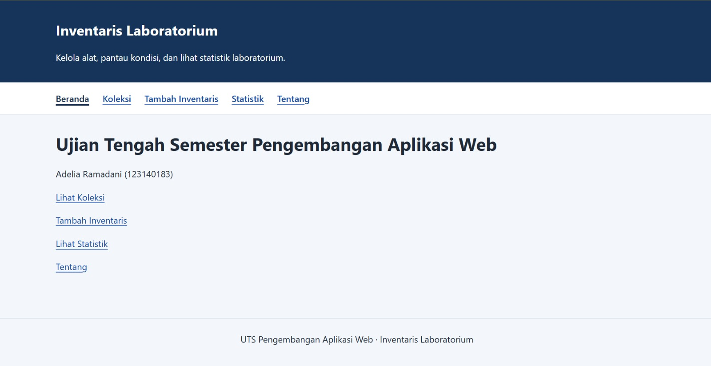
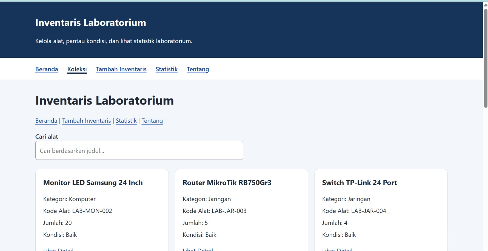
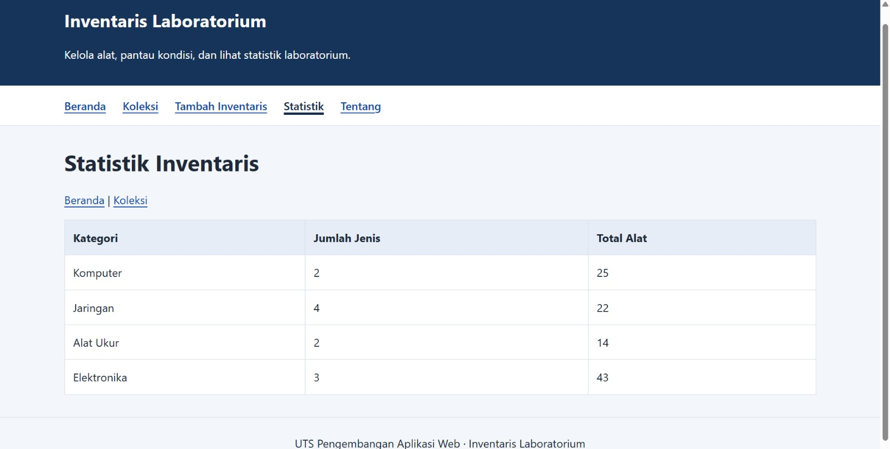
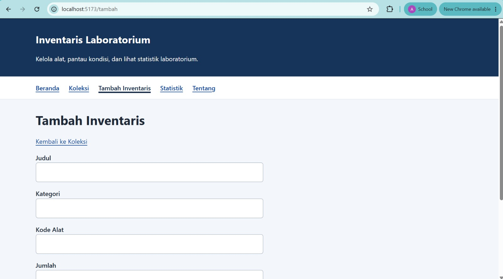

# UTS Pengembangan Aplikasi Web

## Identitas

Nama: Adelia Ramadani  
NIM: 123140183  
Kelas: RB  
Tema: Inventaris Laboratorium  

## URL Deployment

https://07-183-adeliaramadani.github.io/uts-paw/

## Fitur Aplikasi

- Menampilkan daftar inventaris laboratorium
- Pencarian inventaris berdasarkan judul
- Menampilkan detail inventaris
- Menambah data inventaris
- Menyimpan data tambahan menggunakan localStorage
- Menghapus data inventaris
- Menampilkan statistik inventaris berdasarkan kategori
- Menampilkan halaman tentang mahasiswa
- Menampilkan halaman 404 untuk route yang tidak tersedia
- Menggunakan React Router
- Menggunakan Context API
- Menggunakan custom hooks
- Responsive design

### Beranda

### Koleksi

### Statistik

### tambah 

